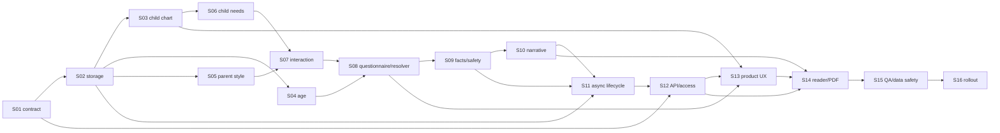

# E22: Astrotype Child Report

## Статус

🟡 В работе — S01–S06 завершены; S07–S16 не начаты

## Цель

Создать вспомогательный отчёт для взрослого caregiver, который объясняет взаимодействие конкретной пары `родитель ↔ ребёнок` и предлагает возрастно-уместные действия взрослого. Отчёт не описывает ребёнка как фиксированную личность, не предсказывает его судьбу и не заменяет медицинскую, психологическую или педагогическую помощь.

Главный вопрос продукта:

> Не «какой мой ребёнок?», а «как мне лучше быть родителем именно для этого ребёнка?»

## Канонические документы

- Product/design source: [`../../design/astrotype_child_report_workflow (1).md`](../../design/astrotype_child_report_workflow%20%281%29.md)
- SRS: [`../../SRS/SRS-E22-child-report.md`](../../SRS/SRS-E22-child-report.md)
- Пользовательский и системный workflow: [`WORKFLOW.md`](./WORKFLOW.md)
- API и state machine: [`API.md`](./API.md)

При расхождении короткой Story с продуктовым смыслом источником истины является SRS вместе с design-документом. Реализация не может ослаблять child-safety, ownership, birth-time uncertainty или immutable lineage.

## Продуктовая формула

```text
Existing Parent Natal Chart
+ Child Natal Chart with birth-time confidence
+ Parent–Child Synastry
+ Current Child Age
+ Versioned Parent Answers
→ Parent Style + Child Needs + Interaction Dimensions
→ deterministic Guidance Facts
→ bounded modular LLM narrative
→ Child Report for Parent
```

LLM не получает задачу самостоятельно рассчитывать карту, синастрию, scores, возраст или parenting conclusions. Она превращает ограниченные evidence-backed Guidance Facts в понятный narrative.

## Продуктовые принципы

1. Объект анализа — взаимодействие конкретной пары, а не «характер ребёнка».
2. Все практические рекомендации направлены на действия взрослого.
3. Детская карта не создаёт отдельный аккаунт и не даёт ребёнку auth capabilities.
4. Пол родителя или ребёнка не участвует в core scoring; caregiver role хранится отдельно.
5. Неизвестное или приблизительное время рождения обрабатывается fail-closed.
6. Core relationship report неизменяем; актуальный возрастной блок хранится отдельными snapshots.
7. Несколько детей одного владельца имеют раздельные charts, answers, generations и artifacts.
8. Narrative failure не уничтожает полезный deterministic result.
9. Web и PDF используют один persisted presentation contract и один зафиксированный age snapshot.
10. Guardrails для данных и текста о несовершеннолетнем строже, чем для обычного Natal Report.

## Пользовательская ценность

Child Report помогает взрослому понять:

- как конкретному ребёнку может быть легче получать поддержку от него;
- как задавать границы без борьбы за власть;
- где естественный стиль родителя помогает контакту;
- где стиль родителя и потребности ребёнка могут расходиться;
- как объяснять новое, поддерживать самостоятельность и реагировать на сильные эмоции;
- какие конфликтные циклы вероятны и как взрослому прервать эскалацию;
- что в реакции ребёнка не следует автоматически принимать на свой счёт;
- что особенно актуально на текущем возрастном этапе.

## MVP scope

### Вход

- существующая Astrotype v2 натальная карта владельца аккаунта;
- child record: имя или псевдоним, дата рождения, место рождения, время и confidence времени;
- `relationship_type` и caregiver context;
- автоматически рассчитанный точный возраст и age stage;
- 8–12 versioned общих и age-filtered контрольных вопросов.

### Deterministic слои

- Parent Style Dimensions;
- Child Needs Dimensions как условия взаимодействия, а не personality traits;
- Parent–Child Synastry;
- Interaction Dimensions;
- Context Resolution;
- Child Guidance Facts;
- safety and confidence markers.

### Выход

1. Как пользоваться отчётом.
2. Ваш естественный стиль родителя.
3. Что помогает этому ребёнку во взаимодействии с вами.
4. Где контакт складывается естественно.
5. Возможные зоны напряжения.
6. Успокоение и поддержка.
7. Границы и правила.
8. Самостоятельность.
9. Объяснение и обучение.
10. Похвала и признание.
11. Конфликтный цикл.
12. Что не принимать на свой счёт.
13. Ваши сильные стороны в этой паре.
14. Осознанные корректировки.
15. Сейчас, в этом возрасте — отдельный versioned age snapshot.

## Вне MVP

- второй родитель и совместный доступ нескольких взрослых;
- Co-Parenting Report;
- sibling synastry и Family Dynamics;
- транзиты, Parenting Calendar и прогноз событий;
- медицинские, психиатрические, юридические или диагностические выводы;
- общий compatibility percentage;
- прогноз способностей, успеваемости, профессии или взрослой личности ребёнка;
- самостоятельный аккаунт ребёнка;
- полноценный score-driven adaptive questionnaire; MVP сохраняет extension point, но использует versioned age-filtered набор.

## Зафиксированные архитектурные решения

1. Birth-time uncertainty входит в MVP, потому что `unknown` является допустимым входом уже в первой версии.
2. `Core Relationship Report` и `Guidance for Current Age` — разные immutable artifacts.
3. Изменение birth data создаёт новую chart/report lineage и не перезаписывает историю.
4. Несколько детей поддерживаются первой версией storage/API.
5. `relationship_type` не является разрешением доступа другому человеку.
6. Канонический product identifier — существующий disabled catalog type `child`; включение возможно только после S01 и rollout gate.
7. Target access — account-level Plus policy E8; frontend не является источником права доступа.
8. Детские персональные данные имеют отдельные retention/export/delete правила до начала production rollout.

## Критерии приёмки Feature

- [x] У `unknown` birth time не используются houses, ASC, MC, house overlays и time-sensitive факты без доказанной устойчивости.
- [x] `approximate` time использует только факты, устойчивые в документированном временном окне.
- [ ] Каждый Parent Style, Child Needs и Interaction score имеет confidence, evidence и version lineage.
- [ ] Ни один вывод не строится из одного астрологического фактора и не маркирует ребёнка бинарным trait.
- [x] Age Resolver календарно корректен, не принимает будущую DOB/возраст `>=18` и создаёт versioned snapshots с server-derived local `as_of_date`.
- [x] Core report не мутирует при взрослении ребёнка; age update создаёт отдельную snapshot/guidance lineage.
- [ ] Guidance Facts являются единственным content input LLM и не содержат unrestricted raw chart/answers.
- [ ] Child-safety validators запрещают диагнозы, фатальные прогнозы, fixed labels, blame, unsafe discipline и unsupported advice.
- [ ] Narrative failure сохраняет доступный `deterministic_ready` report.
- [ ] Два ребёнка одного владельца не смешивают chart, answers, scores, generations, cache или artifacts.
- [ ] Foreign-owner IDs не раскрывают существование child record/report; locked payload не содержит protected fields.
- [ ] Create/complete/regenerate/age-update idempotent и retry-safe.
- [ ] Web и PDF используют одинаковые section order, safety-filtered payload и pinned `age_snapshot_id`.
- [ ] Export/delete/retention contract для данных ребёнка проверен integration tests.
- [ ] Staging smoke покрывает exact/approximate/unknown time, multiple children, locked/foreign access, provider failure и PDF parity.

## Stories

| ID  | Story                                                                                         | Статус       |
| --- | --------------------------------------------------------------------------------------------- | ------------ |
| S01 | [Product, access, privacy и safety contract](./S01-product-access-privacy-safety-contract.md) | ✅ Завершено |
| S02 | [Storage, lineage и multiple children](./S02-storage-lineage-multiple-children.md)            | ✅ Завершено |
| S03 | [Child chart и birth-time confidence](./S03-child-chart-birth-time-confidence.md)             | ✅ Завершено |
| S04 | [Age Resolver и age snapshots](./S04-age-resolver-age-snapshots.md)                           | ✅ Завершено |
| S05 | [Parent Style engine](./S05-parent-style-engine.md)                                           | ✅ Завершено |
| S06 | [Child Needs engine](./S06-child-needs-engine.md)                                             | ✅ Завершено |
| S07 | [Synastry и Interaction engine](./S07-synastry-interaction-engine.md)                         | ⬜ Не начато |
| S08 | [Questionnaire и Context Resolver](./S08-questionnaire-context-resolver.md)                   | ⬜ Не начато |
| S09 | [Guidance Facts и child-safety gates](./S09-guidance-facts-safety-gates.md)                   | ⬜ Не начато |
| S10 | [Modular LLM narrative](./S10-modular-llm-narrative.md)                                       | ⬜ Не начато |
| S11 | [Async generation lifecycle](./S11-async-generation-lifecycle.md)                             | ⬜ Не начато |
| S12 | [API, ownership и access enforcement](./S12-api-ownership-access.md)                          | ⬜ Не начато |
| S13 | [Child management и questionnaire UX](./S13-child-management-questionnaire-ux.md)             | ⬜ Не начато |
| S14 | [Reader, dynamic age block и PDF](./S14-reader-pdf-age-parity.md)                             | ⬜ Не начато |
| S15 | [QA, observability и data safety](./S15-qa-observability-data-safety.md)                      | ⬜ Не начато |
| S16 | [Rollout runbook и live evidence](./S16-rollout-runbook-live-evidence.md)                     | ⬜ Не начато |

## Порядок реализации



## Зависимости

- V2-E2 database foundation.
- V2-E3 natal chart adapter.
- V2-E5 facts/evidence.
- V2-E6 synthesis/outline ownership patterns.
- V2-E7/V2-E15 modular real-provider LLM runtime.
- V2-E10 async API/status lifecycle.
- V2-E11 responsive report reader.
- E6 billing lifecycle и E8 account-level report access.
- E10 birth-data refinement patterns для versioned corrections.

## Документационная готовность

Feature, SRS, workflow, API и атомарные Stories подготовлены. S01 закрыта исполняемыми backend contracts и unit evidence; S02 закрыта additive PostgreSQL storage, enforced lineage/immutability, idempotency, full-graph reconstruction и purge/rollback integration evidence; S03 закрыта versioned exact/approximate/unknown chart policy, stability/exclusion evidence, Moon-boundary golden fixtures и immutable correction lineage; S04 закрыта calendar-correct under-18 resolver, server-owned local effective date, immutable input-hashed snapshots, fresh committed state после shared correction/snapshot lock, side-effect-free cross-date age-update replay, fail-safe conditional downgrade, owner-scoped age update lineage и shared pinned web/PDF read contract; S05 закрыта deterministic восьмимерным Parent Style engine с persisted v2 facts/evidence only, одновременным multi-family и canonical persisted-source-lineage neutral fail-closed, key-first mixed-lineage deduplication/refs, strict finite numeric и nested JSON reload validation, malformed-provenance timing exclusion, chart engine `0.1.6` cache boundary, sign/aspect/balance-sensitive rules, correlation caps, confidence decomposition, current-version filtering, coexistence old/current PostgreSQL profiles, version-aware uniqueness и fail-safe conditional migration downgrade. S06 закрыта deterministic десяти-мерным Child Needs engine `child-needs-mvp-1`/`child-needs-reference-1`, который читает только pinned `ChildChartVersion`, fail-closed исполняет exact/approximate/unknown policy, требует две signal families и две canonical source lineages, сохраняет neutral low-evidence semantics, strict nested JSON reload validation, advisory-lock idempotency, old/current PostgreSQL coexistence и fail-safe conditional migration downgrade. Synastry/Interaction, Context Resolver, Guidance Facts, API routes, frontend, runtime и rollout остаются в S07–S16.
