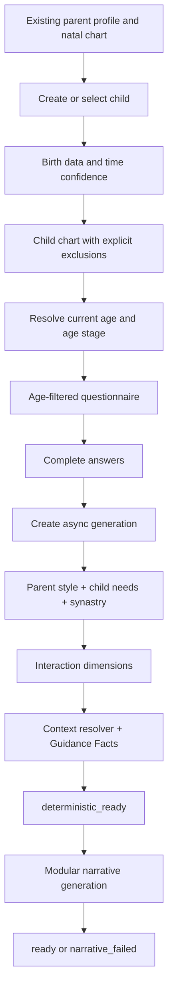
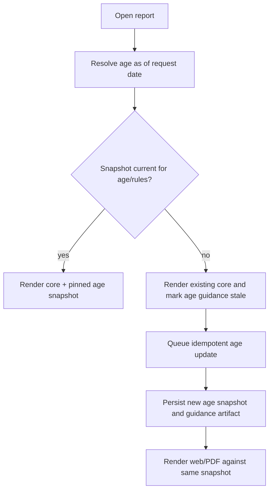

# E22 Child Report — Workflow

## Назначение

Документ описывает пользовательский сценарий и фактическое движение данных. Child Report запускается взрослым владельцем аккаунта из существующего Natal Report или product surface и всегда строится для явно выбранного child record.

## 1. Основной сценарий



### Что выполняется синхронно

- проверка ownership и Plus access;
- создание/выбор child record;
- валидация birth data и `birth_time_confidence`;
- получение questionnaire draft;
- сохранение ответов;
- создание idempotent generation и возврат `generation_id`.

### Что выполняется асинхронно

- расчёт и persistence child chart;
- Parent Style, Child Needs, synastry и Interaction Dimensions;
- Context Resolver и Guidance Facts;
- секционная LLM-генерация;
- финальная assembly и PDF-ready presentation manifest.

## 2. Несколько детей

- Dashboard показывает отдельные child records и последний статус каждого отчёта.
- Родительская карта может переиспользоваться как immutable input reference.
- У каждого ребёнка собственные birth data, chart lineage, questionnaire sessions, answers, generations, reports и age snapshots.
- Cache keys всегда включают `owner_id`, `child_id`, chart/report version и rules version.
- Любое destructive/edit действие показывает имя или псевдоним выбранного ребёнка.
- Cross-child reuse допустим только для domain-neutral reference data; ответы, facts и prose не переиспользуются.

## 3. Неизвестное или приблизительное время рождения

### `exact`

Используется полный набор фактов при валидном времени и месте рождения.

### `approximate`

Backend рассчитывает документированное временное окно и оставляет только устойчивые факты. Неустойчивые houses, angles, Moon/sign или aspect details исключаются и снижают confidence.

### `unknown`

Система не использует:

- houses;
- Ascendant и MC;
- house overlays;
- time-sensitive Moon conclusions;
- любые derived facts, требующие отсутствующего времени.

Пользователь всё равно получает отчёт по устойчивым planet/sign/aspect данным, возрасту, ответам и взаимодействию, но интерфейс объясняет ограничения без давления «угадать» время.

### Уточнение времени позже

```text
edit child birth data
→ create new child chart version
→ invalidate only dependent target artifacts
→ create new report lineage on request
→ preserve previous report and age snapshots
```

## 4. Возрастное обновление



Age update не меняет core pair scores и narrative. Пересчёт pair foundation требуется только при изменении birth data, chart engine, scoring/reference rules или явно выбранной полной regeneration.

## 5. Failure и retry

### Narrative provider failure

- transient status: `narrative_retry_waiting` с persisted `next_retry_at` и exponential backoff; после исчерпания попыток: `narrative_failed`;
- deterministic report и уже готовые sections остаются доступными, без возврата в plain `queued`;
- retry запускает только незавершённые sections; manual failed-section retry фиксирует source segment identities/hashes и Guidance Facts hash;
- provider intent фиксируется commit до external call; outcome-unknown после crash не вызывается повторно;
- chart, dimensions и answers повторно не вычисляются;
- отключённый LLM сразу даёт явный `child_narrative_disabled`, без fake-ready prose и бесполезного retry loop.

### Age update failure

- предыдущий age snapshot остаётся читаемым и помечается датой;
- core report остаётся доступным;
- retry использует тот же idempotency scope, если входы не изменились.

### Partial section failure

- готовые sections сохраняются;
- клиент показывает честный progressive state;
- final `ready` возможен только после обязательных safety/assembly gates.

### Потеря Plus access

- backend возвращает locked metadata без имени ребёнка, DOB, answers, facts, prose и artifact URL;
- policy чтения ранее оплаченных/созданных artifacts определяется S01 и E8, а не frontend.

### Foreign-owner ID

- API отвечает неразличимым `404`;
- логи не содержат protected payload;
- никакие status/versions/PDF endpoints не подтверждают существование объекта.

## 6. Удаление и архивирование

До реализации S02/S12 S01 обязан выбрать точную политику:

- soft archive для обычного скрытия из UI;
- export по запросу владельца;
- hard delete/anonymization персональных child data по privacy contract;
- порядок удаления derived charts, answers, reports, PDFs и provider payloads;
- audit event без сохранения лишних данных несовершеннолетнего.

Удаление не должно случайно каскадировать в parent profile, billing или другие child records.
