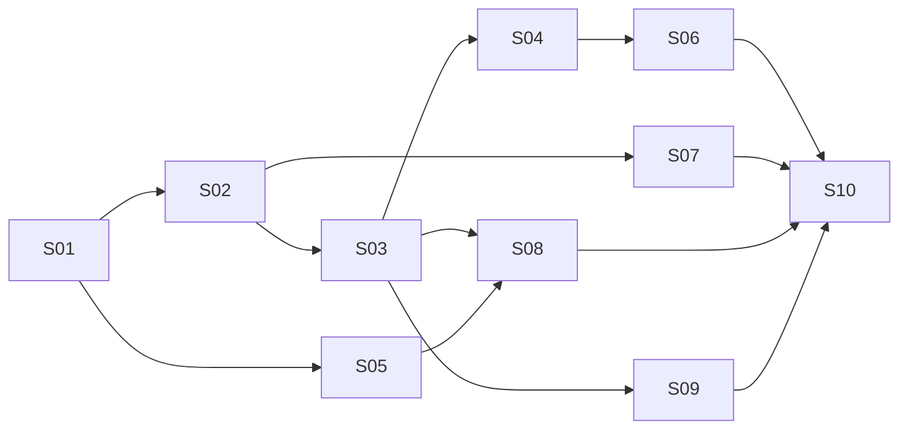

# E23: Business monitoring and privacy-safe acquisition analytics

**Цель (SMART):** завершить S01–S10 проверяемыми срезами: owner-only business dashboard, typed atomic events, quality/cost visibility и default-off external analytics с отдельной live приёмкой.

Status: 🟡 Implementation in progress. Not deployed/accepted. No external counter, legal approval or Telegram recipient supplied.

## Canonical contracts

- [Business monitoring](../../architecture/business-monitoring-contract.md)
- [Event registry](../../architecture/analytics-event-registry.md)
- [Payment confirmation baseline](../../architecture/current-payment-confirmation-flow.md)

## Stories

| Story                                       | Scope                                                | Status                         |
| ------------------------------------------- | ---------------------------------------------------- | ------------------------------ |
| [S01](./S01-kpi-privacy-contract.md)        | KPI, privacy и эксплуатационные gates (T01)          | ✅ Local complete              |
| [S02](./S02-event-outbox.md)                | Typed business events и transactional outbox (T02)   | ✅ Local complete              |
| [S03](./S03-authoritative-producers.md)     | Authoritative domain producers (T03)                 | 🟡 In progress                 |
| [S04](./S04-business-overview-api.md)       | Read-only business overview API (T04)                | 🟡 Implemented; review pending |
| [S05](./S05-consent-attribution-metrica.md) | Consent, attribution и public-only Метрика (T05)     | 🟡 In progress                 |
| [S06](./S06-business-dashboard.md)          | Защищённый business dashboard (T06)                  | 🟡 Local browser checks passed |
| [S07](./S07-aggregation-alerts.md)          | Aggregation, digest и alerts (T07)                   | 🟡 Local runtime checks passed |
| [S08](./S08-yandex-conversion-export.md)    | Gated initial LIVE conversion export (T08)           | 🟡 Local runtime checks passed |
| [S09](./S09-cost-coverage-backfill.md)      | Cost coverage и controlled projection backfill (T09) | 🟡 In progress                 |
| [S10](./S10-verification-rollout.md)        | Integrated verification и rollout (T10)              | 🟡 Integration checks started  |

## Feature acceptance

- [ ] Every Story closed with spec and code-quality review and fresh local verification.
- [ ] No changes to paid access, merchant credentials, saved reports or LLM retry policy for analytics convenience.
- [ ] External activation has explicit owner inputs and actual network/delivery/financial readback evidence.

## Delivery order

External gates remain OPEN until actually executed: counter owner/ID/policy, retention and legal sign-off, approved admin/Telegram/budget, staging actual-SDK network proof, LIVE PSP/renewal/refund acceptance. Their absence does not authorize inventing secrets or silently enabling exports.
